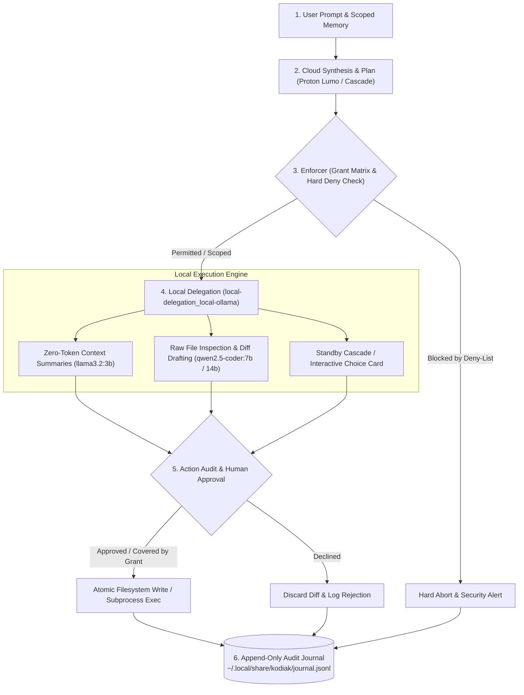
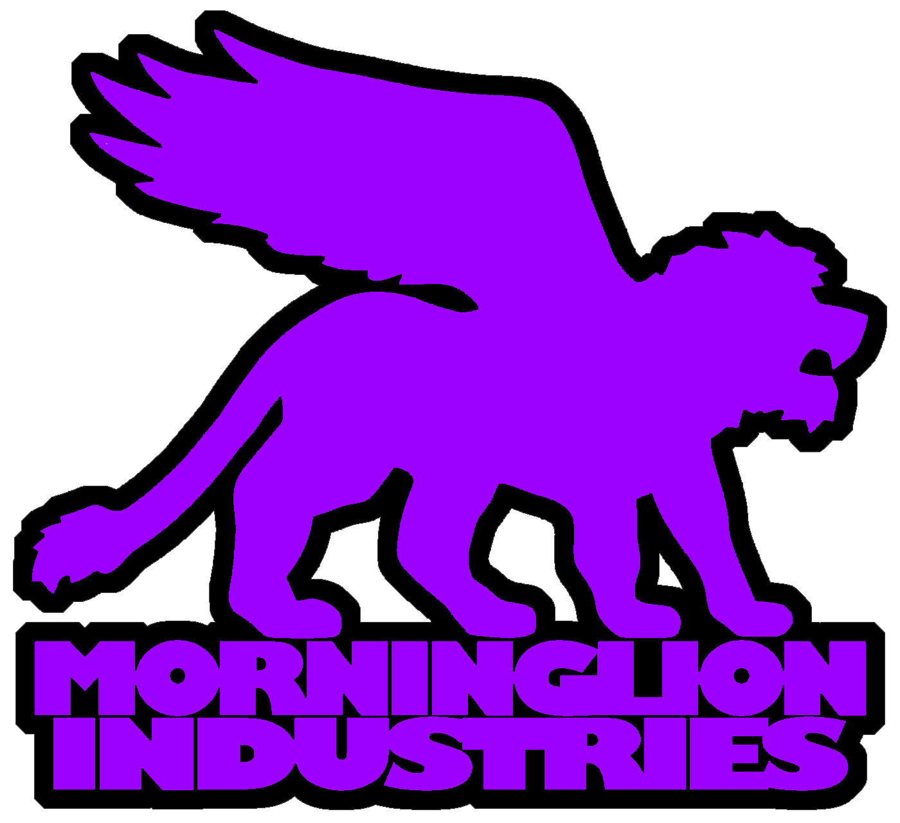

<div align="center">
  <a id="readme-top"></a>
  

  # Kodiak

  **Autonomous Desktop Orchestrator & Local-First AI Development Partner for Linux & Windows**

  [](https://github.com/morganlowe/Kodiak/releases)
  [](LICENSE)
  [](#prebuilt-packages)
  [](#system-architecture)
  [](#the-four-charter-security-model)

  [**Releases**](https://github.com/morganlowe/Kodiak/releases) · [**Report Bug**](https://github.com/morganlowe/Kodiak/issues) · [**Request Feature**](https://github.com/morganlowe/Kodiak/issues) · [**Security Advisories**](https://github.com/morganlowe/Kodiak/security/advisories)

  ---

  [Why Kodiak](#why-kodiak) · [Security Model](#the-four-charter-security-model) · [Architecture](#system-architecture) · [Features](#feature-highlights) · [Packages](#prebuilt-packages) · [Quick Start](#quick-start-from-source) · [Projects Wiki](#projects-wiki-companion-kodiak-projectswiki) · [Config](#configuration-reference) · [FAQ](#faq)
</div>

---


---

## Why Kodiak?

Conventional cloud coding agents require blanket filesystem access, execute unverified shell pipelines, and silently stream proprietary source code across third-party APIs. Fragile CLI wrappers add latency and brittleness on top.

**Kodiak** takes a different path: it is a native cross-platform desktop orchestrator for Linux and Windows built with **[Rust](https://www.rust-lang.org/) ([Tauri v2](https://v2.tauri.app/))**, the **[Tokio](https://tokio.rs/)** async runtime, and modern **[TypeScript](https://www.typescriptlang.org/)**. Cloud models plan and verify using *sanitized metadata only*, while local **[Ollama](https://ollama.com/)** models execute every raw file read, code generation step, and diff draft directly on your hardware. Every action is governed by an explicit permission matrix and recorded to an immutable local audit trail.

> **Core Philosophy:** High-reasoning cloud synthesis + zero-cost local GPU execution + cryptographically verifiable filesystem boundaries.

---

## The Four-Charter Security Model

Kodiak enforces four strict, non-negotiable principles:

* **§ 1. Your Files Stay Home (Local-First Isolation):** Kodiak touches nothing outside explicitly whitelisted project directories. Cloud synthesis is strictly isolated to sanitized architectural plans and metadata. Local models (`local-delegation_local-ollama` running `llama3.2:3b` and `qwen2.5-coder:7b`/`14b`) handle raw file inspection, register maps, compiler output parsing, and unified diff reviews at zero cloud token cost.
* **§ 2. Nothing Happens Without You (Human Authority):** File writes, command executions, and deletions require explicit human consent or must match strict, downward-only grant levels (`READ`, `CREATE`, `BUILD`, `AUTONOMOUS`). An unbypassable hard deny-list protects root system directories, SSH keys, cloud credentials, `.env` secrets, shell profiles, and `.git/` history — even in `AUTONOMOUS` mode.
* **§ 3. Standby Failover & Automated Cascade:** Kodiak uses **Proton Lumo** (via the local `lumo-tamer` bridge) as its primary zero-access cloud reasoning engine. When cloud quotas are exhausted or rate limits (`429`/`503`) hit, Kodiak never crashes or loses state. It either executes an opt-in **Automated Failover Cascade** across configured standby OpenAI-compatible endpoints ([Google Gemini](https://aistudio.google.com/), [Groq](https://groq.com/), [OpenRouter](https://openrouter.ai/)) or presents interactive **Choice Cards** to pivot to local Ollama execution.
* **§ 4. Projects Wiki & AI Knowledge Hub (`kodiak-projectswiki`):** An optional, loosely coupled companion subsystem that transforms scattered hardware, firmware, software, and 3D printing projects into a unified, searchable local knowledge portal served via **[MkDocs Material](https://squidfunk.github.io/mkdocs-material/)** at `http://wiki.local:8000` (fallback: `http://127.0.0.1:8000`).

---

## System Architecture

Kodiak's backend pipelines decouple reasoning from execution across an asynchronous Tokio runtime, ensuring deterministic state verification at every phase:



---

## Feature Highlights

### Granular Grant Matrix & Destructive Diff Interceptor

Permissions are configured per whitelisted directory and never escalate without explicit session approval:

| Grant | Capabilities |
| :--- | :--- |
| **`READ`** | Inspect files and propose unified diffs only; every modification queues for manual human approval. |
| **`CREATE`** | Everything in `READ`, plus creating new, pre-planned files (never overwrites existing files). |
| **`BUILD`** | Everything in `CREATE`, plus directory creation (`mkdir`) and sandboxed build/test toolchain execution. |
| **`AUTONOMOUS`** | Full read/write/execute within the target project tree, strictly bounded by the global hard deny-list. |

> **Safety Gate:** At any grant level, the **Destructive Diff Interceptor** flags any patch that modifies or deletes **≥ 40%** of an existing file for mandatory manual review.

<details>
<summary><strong>Standby Failover, Live Model Discovery & Memory Bank (Click to expand)</strong></summary>
<br />

* **Automated Failover Cascade:** Configure an ordered list of standby providers. With explicit privacy consent (`cascade.consent = true`), Kodiak automatically routes planning metadata to secondary endpoints upon primary failure.
* **Interactive Choice Cards:** When cascade is disabled or exhausted, Kodiak pauses the pipeline and surfaces an in-app Choice Card — switch to local Ollama inference (`qwen2.5-coder:7b` or `14b`), retry an alternate provider, or defer the run.
* **Live Model Discovery & Auto-Tiering:** Uses `ModelService.ListModels` for Google AI Studio (Gemini) and standard `/models` endpoints for OpenAI-compatible providers (Groq, OpenRouter, Lumo, Ollama). Discovered models are mapped into `Low`, `Medium`, and `High` execution tiers.
* **Scoped Memory Bank (`@memory-tag`):** Persist architectural decisions, hardware pinouts, and coding conventions per project. Delivery receipts (**Memory Chips**) verify injected context nodes, backed by an append-only decision journal (`~/.local/share/kodiak/journal.jsonl`) and per-run logs (`~/.local/share/kodiak/runs/<task-id>/run.log`).

</details>

<details>
<summary><strong>Ergonomic Desktop UI Features (Click to expand)</strong></summary>
<br />

* **Zero-Jump Scroll Persistence:** Dual-`requestAnimationFrame` (dual-RAF) viewport locking prevents scroll resets during live streaming and background runs.
* **Custom Slim Scrollbars:** Clean dark theme (`docs/THEME.md`) with custom WebKit scrollbars that eliminate bulky GTK stepper collisions.
* **Collapsible Workspace Panels:** Toggle Project Whitelists, Alternate Providers, Memory Bank, and the Local Decision Journal in one keystroke.
* **Right-Click Project Exclusions:** Right-click any project in the left sidebar to exclude it from the active workspace listing (`exclusion_list` in **Settings → Excluded Projects**).
* **Live Custom CSS Styling:** Inject custom styles into the main interface in real-time from **Settings → Custom CSS (Main Window)**, persisted in `config.toml`.

</details>

<div align="right"><a href="#readme-top">↑ Back to top</a></div>

---

## Prebuilt Packages

Download ready-to-run binaries from the [**GitHub Releases**](https://github.com/morganlowe/Kodiak/releases) page. Select your operating system below for installation commands:

<details open>
<summary><strong>Arch Linux & Derivatives (CachyOS, EndeavourOS, Manjaro)</strong></summary>
<br />

Kodiak provides a split `PKGBUILD` producing the desktop orchestrator (`/usr/bin/kodiak`) and the optional documentation hub (`kodiak-projectswiki`, installed to `/usr/share/kodiak/projectswiki/`).

```bash
# Install both Core Orchestrator and Projects Wiki
sudo pacman -U kodiak-1.1.5-1-x86_64.pkg.tar.zst kodiak-projectswiki-1.1.5-1-any.pkg.tar.zst

# Or install Core Orchestrator only
sudo pacman -U kodiak-1.1.5-1-x86_64.pkg.tar.zst
```

To build and install directly from source via `makepkg` / `make`:

```bash
git clone [https://github.com/morganlowe/Kodiak.git](https://github.com/morganlowe/Kodiak.git)
cd Kodiak
make install
```

</details>

<details>
<summary><strong>Linux Universal AppImage</strong></summary>
<br />

Single standalone binary with zero dependencies — works on all modern Linux distributions:

```bash
chmod +x Kodiak_1.1.5_amd64.AppImage
./Kodiak_1.1.5_amd64.AppImage
```

</details>

<details>
<summary><strong>Debian / Ubuntu (.deb)</strong></summary>
<br />

```bash
sudo dpkg -i dist/deb/kodiak_1.1.5-1_amd64.deb dist/deb/kodiak-projectswiki_1.1.5-1_all.deb
sudo apt-get install -f
```

</details>

<details>
<summary><strong>Windows 10 & 11 (NSIS Setup Installer)</strong></summary>
<br />

Download **`Kodiak_1.1.5_x64-setup.exe`** from [GitHub Releases](https://github.com/morganlowe/Kodiak/releases).

* Packages both the **Kodiak** desktop orchestrator and the standalone **ProjectsWiki** engine (`kodiak-projectswiki.exe`).
* Zero Python or pip setup required: includes an embedded MkDocs Material runtime, Sync API, and automated catalog generator.

**Windows Prerequisites:**
1. Install [Ollama for Windows](https://ollama.com/download/windows) (running on `http://127.0.0.1:11434`).
2. Pull the required local models in PowerShell:
   ```powershell
   ollama pull llama3.2:3b
   ollama pull qwen2.5-coder:7b
   ```
3. Microsoft Edge WebView2 runtime (pre-installed on Windows 10/11).

**Building from Source on Windows:**
```powershell
git clone [https://github.com/morganlowe/Kodiak.git](https://github.com/morganlowe/Kodiak.git)
cd Kodiak
npm install
npm run build
python scripts/build_windows_wiki.py
cargo tauri build --bundles nsis
```

</details>

<details>
<summary><strong>Systemd User Service Integration (Linux Wiki Daemon)</strong></summary>
<br />

`kodiak-projectswiki` ships an opt-in systemd user unit at `/usr/lib/systemd/user/kodiak-projectswiki.service`. Start it via the Kodiak UI or manually from your terminal:

```bash
systemctl --user daemon-reload
systemctl --user start kodiak-projectswiki.service

# Optional: Enable automatically at login
systemctl --user enable --now kodiak-projectswiki.service
```

</details>

---

## Quick Start (From Source)

### 1. Prerequisites
* **[Rust](https://rustup.rs/)** `1.78+` & **[Node.js](https://nodejs.org/)** `v20+`
* **[Ollama](https://ollama.com/)** running locally
* **Linux:** Tauri v2 WebKitGTK headers (`webkit2gtk-4.1`)

### 2. Pull Local Models & Build

```bash
# 1. Pull required Ollama models
ollama pull llama3.2:3b
ollama pull qwen2.5-coder:7b
ollama pull qwen2.5-coder:14b

# 2. Clone and install frontend dependencies
git clone [https://github.com/morganlowe/Kodiak.git](https://github.com/morganlowe/Kodiak.git)
cd Kodiak
npm install

# 3a. Run in development mode (with hot-reload)
npm run tsc && cargo tauri dev

# 3b. Or build optimized production binaries
npm run build && cargo tauri build
```

The compiled binary is output to `src-tauri/target/release/kodiak`. A default configuration is created at `~/.config/kodiak/config.toml` on first launch.

<div align="right"><a href="#readme-top">↑ Back to top</a></div>

---

## Projects Wiki Companion (`kodiak-projectswiki`)


For makers, embedded engineers, and polyglot developers, project catalogs fragment quickly across Git repositories, datasheets, CAD files, and BOM spreadsheets. **`kodiak-projectswiki`** is an optional, 100% local companion subsystem that monitors your project directories, indexes schematics/manuals, and uses local Ollama models to generate standardized documentation at zero cloud cost.

### Wiki Operations

| Operation | Kodiak Wiki Tab Button | CLI Command |
| :--- | :--- | :--- |
| Start wiki services | `Start Projects Wiki Server` | `wiki.sh start` |
| Rescan & update navigation | `Sync Catalog` | `wiki.sh sync` |
| Index PDFs & schematics | `Rebuild Assets` | `wiki.sh assets` |
| Generate docs via AI | `AI Build Doc` | `python build_wiki.py --project <name>` |
| Stop wiki services | `Stop` | `wiki.sh stop` |
| Open in system browser | `External` | `xdg-open http://wiki.local:8000` |

<details>
<summary><strong>View Wiki Architecture Diagram & Four-Layer Pipeline (Click to expand)</strong></summary>
<br />

```text
┌────────────────────────────────────────────────────────────────────────┐
│                           KODIAK DESKTOP APP                           │
│  [Workbench]   [Projects Wiki Tab]   [Settings]                        │
└───────────────────────┬────────────────────────────────────────────────┘
                        │ Embeds via iframe or launches in system browser
                        ▼
┌────────────────────────────────────────────────────────────────────────┐
│                   WIKI WEB SERVER (Port 8000)                          │
│  MkDocs Material • Instant Search Index • High-Density Theme           │
│  [http://wiki.local:8000](http://wiki.local:8000)   (fallback: [http://127.0.0.1:8000](http://127.0.0.1:8000))            │
└───────────────────────▲────────────────────────────────────────────────┘
                        │ Serves compiled static HTML & indexed assets
┌───────────────────────┴────────────────────────────────────────────────┐
│                   SYNC & ASSET API (Port 8765)                         │
│  Lightweight local Python daemon (wiki.sh / sync_api.py)               │
│  • Monitors projects_dir from ~/.config/kodiak/wiki.toml               │
│  • Manages project_overrides.json (titles, pinned tags, icons)         │
│  • Indexes datasheets, schematics, manuals, photos, Gerbers            │
│  • Serves raw asset previews & status endpoints to Kodiak UI           │
└───────────────────────▲────────────────────────────────────────────────┘
                        │
┌───────────────────────┴────────────────────────────────────────────────┐
│                   LOCAL AI DOCUMENTATION GENERATOR                     │
│  Local Ollama Engine (qwen2.5-coder:7b / llama3.2:3b)                  │
│  • Reads codebases, Git logs, pin definitions, wiring notes            │
│  • Synthesizes structured Markdown: Overview, BOM, Pinouts, Setup      │
│  • Zero cloud cost, zero third-party data exfiltration                 │
└────────────────────────────────────────────────────────────────────────┘
```

#### Four-Layer Pipeline
1. **MkDocs Material Documentation Engine (Port 8000):** Compiles structured Markdown into a fast static web app with instant search, category filtering, dark slate & burnt orange theme, and high-density typography (`html { font-size: 80%; }`).
2. **Sync & Asset Daemon (Port 8765):** Local Python REST service (`sync_api.py`) that discovers directories, parses Git remotes, calculates language/file stats, tracks hardware assets, and preserves manual overrides in `~/.config/kodiak/project_overrides.json`.
3. **Automated Directory Scanner (`wiki.sh sync` / `make_wiki.py`):** Recursively traverses your projects root, auto-categorizes repositories (*Hardware & Electronics*, *Embedded & Firmware*, *Software & Utilities*, *Audio & Synthesizers*, *3D Printing & CAD*), and builds `mkdocs.yml`.
4. **Local AI Documentation Generator (`build_wiki.py` / `wiki-ai`):** Feeds directory structures, code comments, and README excerpts to local Ollama (`qwen2.5-coder:7b`) to generate standardized engineering docs (Purpose, BOM, Pinouts, Build/Flash steps, Architectural notes).

#### Integration & Security Boundaries
* **Strictly Optional:** Install `kodiak` standalone without `kodiak-projectswiki`; the Wiki tab hides cleanly when absent.
* **Zero-Sudo Hostname (`wiki.local`):** Mapping `127.0.0.1 wiki.local` in `/etc/hosts` happens only with explicit consent; otherwise falls back to `http://127.0.0.1:8000`.
* **Read-Only Source Boundary:** Generated wiki output lives in `~/.local/share/kodiak/wiki/`, completely decoupled from your project repositories.

</details>

---

## Workflow & Keyboard Shortcuts

1. **Scope Workspace (`Ctrl + 1`):** Select a whitelisted project directory and verify its grant level (`READ`, `CREATE`, `BUILD`, `AUTONOMOUS`).
2. **Submit Task (`Ctrl + Enter`):** Enter a plain-language prompt (use `@memory-tag` to inject pinouts or specs).
3. **Local Inspection & Cloud Plan:** `llama3.2:3b` summarizes local files at zero token cost; sanitized metadata goes to Proton Lumo (or standby cascade) for planning.
4. **Local Code Drafting:** Local `qwen2.5-coder:7b` / `14b` workers inspect source trees and draft unified diffs.
5. **Audit & Apply (`Ctrl + Shift + A`):** Review diffs and any Destructive Diff warnings in the Action Audit Queue, then apply atomically.

<details>
<summary><strong>Full Keyboard Shortcut Reference (Click to expand)</strong></summary>
<br />

| Shortcut | Action |
| :--- | :--- |
| `Ctrl + Enter` | Submit current task prompt to the active planning pipeline |
| `Ctrl + Shift + A` | Approve & grant the focused Action Card in the queue |
| `Ctrl + Shift + D` | Decline & discard the focused Action Card diff |
| `Ctrl + 1` | Toggle **Project Whitelists** panel |
| `Ctrl + 2` | Toggle **Alternate Providers & Live Discovery** panel |
| `Ctrl + 3` | Toggle **Memory Bank** panel |
| `Ctrl + 4` | Toggle **Local Decision Journal** panel |
| `Ctrl + L` | Open the **Per-Run Diagnostic Log** viewer (`run.log`) |
| `Ctrl + ,` | Open Global Settings & Cascade Configuration modal |
| `Ctrl + W` | Switch to **Projects Wiki** tab / launch `http://wiki.local:8000` |
| `Esc` | Dismiss active modal or abort an unapproved in-flight prompt |

</details>

---

## Configuration Reference

Kodiak generates default configuration files on first launch. Expand the sections below for complete, annotated production examples:

<details>
<summary><strong>1. Core Orchestrator — <code>~/.config/kodiak/config.toml</code> (Click to expand)</strong></summary>
<br />

```toml
# Kodiak v1.1.5 Core Orchestrator Configuration

[general]
theme = "kodiak-dark"
journal_path = "~/.local/share/kodiak/journal.jsonl"
runs_dir = "~/.local/share/kodiak/runs"
run_log_level = "info"          # Options: "debug" | "info" | "warn" | "error"
run_log_max_mb = 50             # Max disk usage for per-run diagnostic logs
run_log_keep_runs = 20          # Recent run logs retained (journal.jsonl is never pruned)
destructive_diff_threshold = 0.40

# Project Exclusions (managed via sidebar right-click or Settings -> Excluded Projects)
exclusion_list = [
  "~/Nextcloud/Projects/archived-experiment"
]

# Custom CSS Overrides (managed via Settings -> Custom CSS)
custom_css = """
/* Injected live into the desktop interface at runtime */
"""

[primary_provider]
name = "lumo"
protocol = "openai-compat"
base_url = "[http://127.0.0.1:3003/v1](http://127.0.0.1:3003/v1)"
tier_low = "lumo-lite"
tier_medium = "lumo"
tier_high = "lumo-max"
timeout_secs = 120

[local_delegation]
pipeline_id = "local-delegation_local-ollama"
ollama_base_url = "[http://127.0.0.1:11434](http://127.0.0.1:11434)"
summary_model = "llama3.2:3b"            # Zero-cloud-token file & log summarizer
worker_model_fast = "qwen2.5-coder:7b"   # Standard local diff & code generation
worker_model_deep = "qwen2.5-coder:14b"  # Heavy refactoring & Choice Card fallback
max_context_tokens = 32768

[cascade]
enabled = true
consent = true                           # Explicit consent to route prompts to standby providers on failure
order = ["gemini", "groq", "openrouter"]
allow_choice_card_on_exhaustion = true

[[alternate_providers]]
id = "gemini"
label = "Google AI Studio (Gemini)"
discovery_mode = "google-native"         # Uses native ModelService.ListModels
base_url = "[https://generativelanguage.googleapis.com/v1beta/openai/](https://generativelanguage.googleapis.com/v1beta/openai/)"
api_key_env = "GEMINI_API_KEY"
tier_low = "gemini-3.0-flash"
tier_medium = "gemini-3.0-flash"
tier_high = "gemini-2.5-pro"

[[alternate_providers]]
id = "groq"
label = "Groq Cloud"
discovery_mode = "openai-models"         # Queries the standard /v1/models endpoint
base_url = "[https://api.groq.com/openai/v1](https://api.groq.com/openai/v1)"
api_key_env = "GROQ_API_KEY"
tier_low = "llama-3.1-8b-instant"
tier_medium = "llama-3.3-70b-versatile"
tier_high = "qwen-2.5-coder-32b"

[[alternate_providers]]
id = "openrouter"
label = "OpenRouter"
discovery_mode = "openai-models"
base_url = "[https://openrouter.ai/api/v1](https://openrouter.ai/api/v1)"
api_key_env = "OPENROUTER_API_KEY"
tier_low = "google/gemini-3.0-flash"
tier_medium = "anthropic/claude-3.5-sonnet"
tier_high = "deepseek/deepseek-r1"

# Granular Project Whitelist Matrix
# Valid grant levels: "READ" | "CREATE" | "BUILD" | "AUTONOMOUS"
[[whitelist]]
path = "~/Nextcloud/Projects/kodiak"
grant = "BUILD"
memory_scope = "kodiak-core"

[[whitelist]]
path = "~/Nextcloud/Projects/embedded-firmware"
grant = "CREATE"
memory_scope = "firmware-hardware"

[[whitelist]]
path = "~/Nextcloud/Projects/datasheets"
grant = "READ"
memory_scope = "hardware-docs"

[security]
# Hard deny-list: globally enforced, even under AUTONOMOUS grant
hard_deny_patterns = [
  "**/.git/**",
  "**/.env*",
  "**/credentials.json",
  "**/*.pem",
  "**/*.key",
  "~/.ssh/**",
  "~/.aws/**",
  "~/.gcp/**",
  "~/.config/gcloud/**",
  "~/.bashrc",
  "~/.zshrc",
  "/etc/**",
  "/root/**"
]
```

</details>

<details>
<summary><strong>2. Projects Wiki — <code>~/.config/kodiak/wiki.toml</code> (Click to expand)</strong></summary>
<br />

The wiki subsystem reads custom metadata from `~/.config/kodiak/project_overrides.json` and writes compiled static output to `~/.local/share/kodiak/wiki/`.

```toml
# Kodiak Projects Wiki & AI Knowledge Hub Configuration

projects_dir = "~/Nextcloud/Projects"
site_domain = "wiki.local"              # Zero-sudo fallback to 127.0.0.1:8000 if unmapped in /etc/hosts
port_web = 8000                         # MkDocs Material documentation server port
port_api = 8765                         # Python Sync & Asset REST API daemon port
ollama_model = "qwen2.5-coder:7b"       # Primary local model for AI Build Doc synthesis

[paths]
overrides_file = "~/.config/kodiak/project_overrides.json"
output_dir = "~/.local/share/kodiak/wiki"

[scanner]
ollama_base_url = "[http://127.0.0.1:11434](http://127.0.0.1:11434)"
summary_model = "llama3.2:3b"
include_extensions = ["md", "rs", "ts", "py", "c", "cpp", "h", "ino", "toml", "pdf", "svd", "scad", "gbr"]
exclude_dirs = ["target", "node_modules", ".git", "dist", "build", "__pycache__"]
```

</details>

---

## FAQ

<details>
<summary><strong>Does my source code ever leave my machine?</strong></summary>
<br />
No. Cloud models only ever receive sanitized structural metadata and architectural summaries — never raw file contents. All raw file reads, code generation, and diff drafting happen locally via Ollama.
</details>

<details>
<summary><strong>What happens when my cloud quota runs out mid-task?</strong></summary>
<br />
Nothing is lost. Kodiak either fails over automatically to your configured cascade providers (with prior consent) or pauses and displays an interactive Choice Card so you can switch to local Ollama execution or defer the run.
</details>

<details>
<summary><strong>Can Kodiak modify my dotfiles or SSH keys?</strong></summary>
<br />
No. The hard deny-list is globally enforced — even in <code>AUTONOMOUS</code> mode — and cannot be bypassed from the UI.
</details>

<details>
<summary><strong>Do I have to install the Projects Wiki?</strong></summary>
<br />
No. It is completely optional. Without it, Kodiak runs as a standalone coding orchestrator and automatically hides the Wiki tab.
</details>

<details>
<summary><strong>Which operating systems and desktop environments are supported?</strong></summary>
<br />
Kodiak supports native Linux desktops via WebKitGTK (<code>webkit2gtk-4.1</code>) with packaged builds for Arch/CachyOS, Debian/Ubuntu, and universal AppImage, as well as Windows 10 & 11 via Microsoft Edge WebView2.
</details>

---

## Contributing & Security

Bug reports, security reviews, and pull requests are welcome at [github.com/morganlowe/Kodiak](https://github.com/morganlowe/Kodiak).

1. Fork the repository and create a feature branch.
2. Run `npm run tsc && cargo tauri dev` to verify your changes compile and pass checks.
3. For behavioral changes, update `DECISIONS.md` and relevant documentation.
4. Submit a Pull Request against `main` with a clear summary of changes.

> **Security Vulnerability Reporting:** Found a vulnerability touching the grant matrix, deny-list, or filesystem boundaries? **Do not open a public issue.** Please report it privately via [GitHub Security Advisories](https://github.com/morganlowe/Kodiak/security/advisories).

---

## License & Acknowledgements

Copyright © 2026 **Morgan Lowe**. Licensed under the **[Apache License, Version 2.0](http://www.apache.org/licenses/LICENSE-2.0)**.

<details>
<summary><strong>View Full Acknowledgements, AI Collaborators & Open-Source Stack (Click to expand)</strong></summary>
<br />

### Primary Author & Systems Architecture
* **Morgan Lowe** — Creator, systems architecture, security model design, multi-platform packaging, and engineering direction.

### AI Model Collaborators
* **Proton Lumo** — Privacy-first collaborative peer and debugging partner via the local `lumo-tamer` bridge.
* **Google Gemini Models** — DeepMind Antigravity agentic orchestration, Gemini 2.5 Pro and Gemini 2.5 Flash for architectural reasoning, multi-tier delegation design patterns, and autonomous verification workflows.
* **OpenAI ChatGPT & o-Series Models** — Architectural planning, systems engineering, reasoning, and core implementation.
* **Anthropic Claude Models** — Claude 3.7 Sonnet and Claude 3.5 Sonnet for deep analytical reasoning, architectural synthesis, and test scaffolding.
* **Local Ollama Models** — `llama3.2:3b`, `qwen2.5-coder:7b`, and `qwen2.5-coder:14b` running offline on local hardware for zero-cloud-token code drafting, diff inspection, compiler log digestion, register map extraction, and syntax verification.

### Core Technologies, Languages & Runtimes
* **Python Ecosystem:** [Python 3](https://www.python.org/), [MkDocs](https://www.mkdocs.org/) & [MkDocs Material](https://squidfunk.github.io/mkdocs-material/), [PyInstaller](https://pyinstaller.org/), PyYAML, and Jinja2.
* **Rust Ecosystem:** [Rust](https://www.rust-lang.org/), [Tauri v2](https://v2.tauri.app/), [Tokio](https://tokio.rs/), Reqwest, Serde & `serde_json`, Sysinfo, Notify, Chrono, and `parking_lot`.
* **Web & Interface:** [TypeScript](https://www.typescriptlang.org/), [Vite](https://vitejs.dev/), HTML5, and modern CSS3 custom properties.
* **Platform Packaging & Tooling:** Arch Linux / CachyOS (`pacman`, `makepkg`), Debian / Ubuntu (`dpkg-deb`), [AppImageKit](https://github.com/AppImage/AppImageKit), and [NSIS](https://nsis.sourceforge.io/).
* **Hardware & Inference:** NVIDIA CUDA & `nvidia-smi` GPU telemetry, and the [Ollama](https://ollama.com/) local inference runtime.

</details>

### Reference Dev Machine ("Frank")

You do not need a multi-GPU workstation or enterprise server rack to build and run Kodiak. The entire system was built and runs daily on **Frank**, a compact 13-inch laptop with 6 GB of VRAM:

| Component | Specification |
| :--- | :--- |
| **System** | ASUS ProArt PX13 (13-inch laptop) |
| **CPU** | AMD Ryzen AI 9 HX 370 (12 cores / 24 threads, Radeon 890M iGPU) |
| **GPU** | NVIDIA GeForce RTX 4050 Laptop GPU (6 GB VRAM) |
| **Memory** | 32 GB System RAM |
| **Storage** | 2 TB NVMe SSD |
| **Operating System** | CachyOS Linux (Arch-based, KDE Plasma) |
| **Local AI Stack** | Ollama (`llama3.2:3b`, `qwen2.5-coder:7b` in-VRAM, `qwen2.5-coder:14b` hybrid offload) |

<div align="center">
  <br />
  
  <p><strong>Created and Engineered by Morgan Lowe</strong></p>
  <p><a href="#readme-top">↑ Back to top</a></p>
</div>
