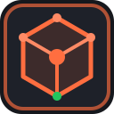
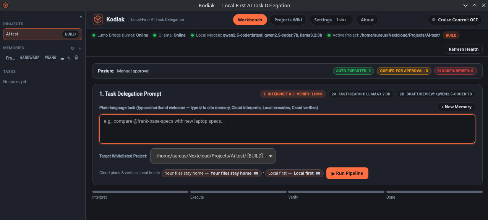
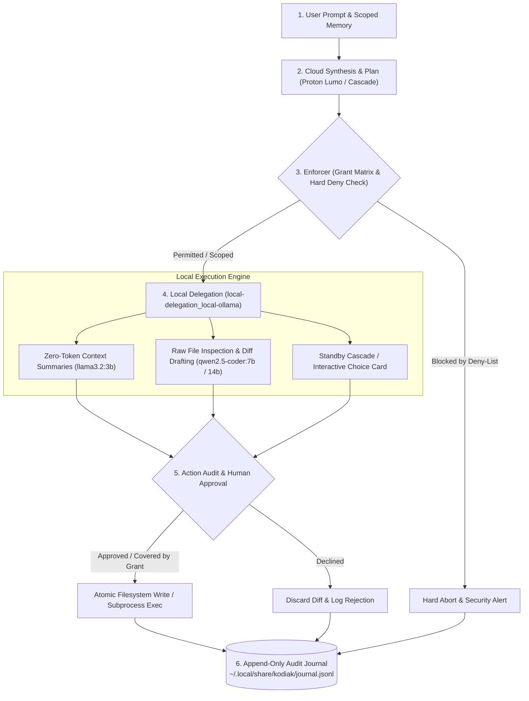
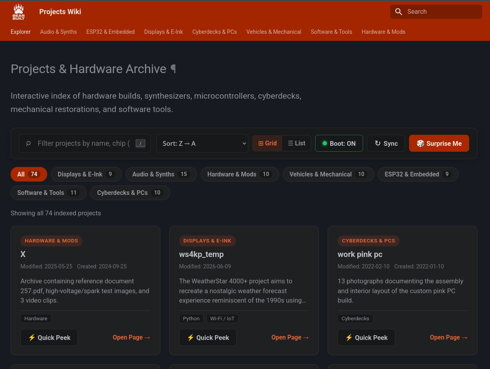
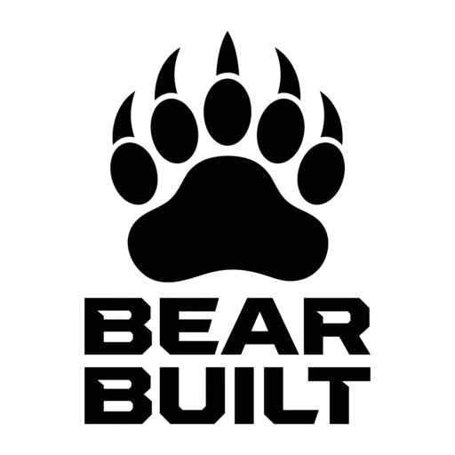

<div align="center">
  

  # Kodiak

  **Autonomous Desktop Orchestrator & Local-First AI Development Partner for Linux & Windows**

  [](#)
  [](LICENSE)
  [](#prebuilt-packages)
  [](#)
  [](#)

  [Why Kodiak](#why-kodiak) · [Security Model](#the-four-charter-security-model) · [Quick Start](#quick-start) · [Configuration](#configuration-reference) · [FAQ](#faq)
</div>

---



---

## Why Kodiak?

Conventional cloud coding agents require blanket filesystem access, execute unverified shell pipelines, and silently stream proprietary source code across third-party APIs. Fragile CLI wrappers add latency and brittleness on top.

**Kodiak** takes a different path: it is a native cross-platform desktop orchestrator for Linux and Windows built with **Rust (Tauri v2)**, the **Tokio** async runtime, and modern **TypeScript**. Cloud models plan and verify using *sanitized metadata only*, while local models execute every raw file read, code generation step, and diff draft directly on your hardware. Every action is governed by an explicit permission matrix and recorded to an immutable local audit trail.

In short: **high-reasoning cloud synthesis + zero-cost local GPU execution + cryptographically verifiable filesystem boundaries.**

---

## The Four-Charter Security Model

Kodiak enforces four strict, non-negotiable principles:

### § 1. Your Files Stay Home (Local-First Isolation)
Kodiak touches nothing outside explicitly whitelisted project directories. Cloud synthesis is strictly isolated to sanitized architectural plans and metadata. Local models (the `local-delegation_local-ollama` pipeline running `llama3.2:3b` and `qwen2.5-coder:7b`/`14b`) handle raw file inspection, register maps, compiler output parsing, and unified diff reviews — at zero cloud token cost.

### § 2. Nothing Happens Without You (Human Authority)
File writes, command executions, and deletions require explicit human consent or must match strict, downward-only grant levels (`READ`, `CREATE`, `BUILD`, `AUTONOMOUS`). An unbypassable hard deny-list protects root system directories, SSH keys, cloud credentials, `.env` secrets, shell profiles, and `.git/` history — even in `AUTONOMOUS` mode.

### § 3. Standby Failover & Automated Cascade
Kodiak uses **Proton Lumo** (via the local `lumo-tamer` bridge) as its primary zero-access cloud reasoning engine. When cloud quotas are exhausted or rate limits (`429`/`503`) hit, Kodiak never crashes or loses state. It either executes an opt-in **Automated Failover Cascade** across configured standby OpenAI-compatible endpoints (Google Gemini, Groq, OpenRouter) or presents interactive **Choice Cards**, letting you pivot to local Ollama execution or defer the task.

### § 4. Projects Wiki & AI Knowledge Hub (`kodiak-projectswiki`)
An optional, loosely coupled companion subsystem that transforms scattered hardware, firmware, software, and 3D printing projects into a unified, searchable local knowledge portal. It indexes PDFs, schematics, and manuals; synthesizes standardized documentation via local Ollama models at zero cloud cost; and serves an interactive **MkDocs Material** portal at `http://wiki.local:8000` (zero-sudo fallback: `http://127.0.0.1:8000`).

---

## System Architecture

Kodiak's backend pipelines decouple reasoning from execution across an asynchronous Tokio runtime, ensuring deterministic state verification at every phase:



---

## Feature Highlights

### Granular Grant Matrix & Destructive Diff Interceptor

Permissions are configured per whitelisted directory and never escalate without explicit session approval:

| Grant | Capabilities |
| :--- | :--- |
| **`READ`** | Inspect files and propose unified diffs only; every modification queues for manual human approval. |
| **`CREATE`** | Everything in `READ`, plus creating new, pre-planned files (never overwrites existing files). |
| **`BUILD`** | Everything in `CREATE`, plus directory creation (`mkdir`) and sandboxed build/test toolchain execution. |
| **`AUTONOMOUS`** | Full read/write/execute within the target project tree, strictly bounded by the global hard deny-list. |

At any grant level, the **Destructive Diff Interceptor** flags any patch that modifies or deletes ≥ 40% of an existing file for mandatory review.

### Standby Failover Cascade & Interactive Choice Cards

- **Automated Cascade**: Configure an ordered list of standby providers. With explicit privacy consent (`cascade.consent = true`), Kodiak automatically routes planning metadata to secondary endpoints upon primary failure.
- **Interactive Choice Cards**: When cascade is disabled or exhausted, Kodiak pauses the pipeline and surfaces an in-app Choice Card — switch to local Ollama inference (`qwen2.5-coder:7b` or `14b`), retry an alternate provider, or defer the run.

### Live Model Discovery & Automatic Tier Resolution

Kodiak dynamically queries provider capabilities without hardcoded model lists:

- **Native Discovery**: Uses `ModelService.ListModels` for Google AI Studio (Gemini) and standard `/models` endpoints for OpenAI-compatible providers (Groq, OpenRouter, Lumo, Ollama).
- **Automatic Tiering**: Discovered models are live-filtered and mapped into `Low` (fast/economical), `Medium` (balanced), and `High` (deep architectural synthesis) execution tiers.

### Memory Bank & Context Scoping

Persist architectural decisions, hardware pinouts, and coding conventions inside a project-scoped **Memory Bank**, referenced directly in prompts via `@memory-tag`. Delivery receipts (**Memory Chips**) verify exactly which context nodes were injected into a run, while the append-only decision journal and per-run logs guarantee complete observability:

- Journal: `~/.local/share/kodiak/journal.jsonl`
- Per-run logs: `~/.local/share/kodiak/runs/<task-id>/run.log`

### Ergonomic WebKitGTK Desktop UI

Engineered specifically for Linux desktop environments:

- **Zero-Jump Scroll Persistence**: Dual-`requestAnimationFrame` (dual-RAF) viewport locking prevents scroll resets during live streaming and background runs.
- **Custom Slim Scrollbars**: Clean dark theme (`docs/THEME.md`) with custom WebKit scrollbars that eliminate bulky GTK stepper collisions.
- **Collapsible Workspace Panels**: Toggle Project Whitelists, Alternate Providers, Memory Bank, and the Local Decision Journal in one keystroke.
- **Right-Click Project Exclusions**: Right-click any project in the left sidebar to exclude it from the active workspace listing. Excluded directories are safely stored in `exclusion_list` and can be restored or managed in **Settings → Excluded Projects**.
- **Live Custom CSS Styling**: Inject custom styles into the main interface in real-time from **Settings → Custom CSS (Main Window)**, persisting across restarts in `config.toml`.

---

## Quick Start

### 1. Install Prerequisites

- **Rust** 1.78+
- **Node.js** v20+
- **Ollama**
- Tauri v2 WebKitGTK headers (`webkit2gtk-4.1`)

### 2. Pull Local Models

```bash
ollama pull llama3.2:3b
ollama pull qwen2.5-coder:7b
ollama pull qwen2.5-coder:14b
```

### 3. Build & Run

```bash
git clone https://github.com/morganlowe/Kodiak.git
cd kodiak
npm install

# Development mode (hot-reload)
npm run tsc && cargo tauri dev

# Optimized production binaries
npm run build && cargo tauri build
```

The compiled binary is produced at `src-tauri/target/release/kodiak`. A default configuration is generated at `~/.config/kodiak/config.toml` on first launch.

### 4. Run Your First Pipeline

1. **Scope your workspace** — open the Projects sidebar (`Ctrl + 1`), pick a whitelisted directory, and verify its grant posture.
2. **Submit a task** — write a plain-language prompt (optionally referencing `@memory-tags`) and hit `Ctrl + Enter`.
3. **Review & approve** — inspect the proposed diff in the Action Audit Queue and press `Ctrl + Shift + A` to apply atomically.

---

## Prebuilt Packages

### Linux (Universal AppImage)

Single standalone binary with zero dependencies — works on all modern Linux distributions:

```bash
# Download Kodiak_1.1.3_amd64.AppImage from GitHub Releases, make executable, and run:
chmod +x Kodiak_1.1.3_amd64.AppImage
./Kodiak_1.1.3_amd64.AppImage
```

### Arch Linux & Derivatives (CachyOS, EndeavourOS, Manjaro)

Kodiak provides a split `PKGBUILD` producing the desktop orchestrator (`/usr/bin/kodiak`) and the optional documentation hub (`kodiak-projectswiki`, installed to `/usr/share/kodiak/projectswiki/` with dependency hooks for `python-mkdocs-material`, `python-requests`, and `python-toml`).

```bash
sudo pacman -U kodiak-1.1.3-1-x86_64.pkg.tar.zst kodiak-projectswiki-1.1.3-1-any.pkg.tar.zst
```

> **Core orchestrator only?** Omit `kodiak-projectswiki-1.1.3-1-any.pkg.tar.zst`.

Or build and install directly from source via `makepkg` or `make`:

```bash
git clone https://github.com/morganlowe/Kodiak.git
cd kodiak
make install
```

### Debian / Ubuntu

```bash
sudo dpkg -i dist/deb/kodiak_1.1.3-1_amd64.deb dist/deb/kodiak-projectswiki_1.1.3-1_all.deb
sudo apt-get install -f
```

### Windows (10 & 11)

Windows builds are generated automatically on release and available from the [GitHub Releases](https://github.com/morganlowe/Kodiak/releases) page:

- **NSIS Setup Installer (`.exe`)**: `Kodiak_1.1.3_x64-setup.exe` (Recommended)
- **WiX Installer (`.msi`)**: `Kodiak_1.1.3_x64_en-US.msi`

#### Windows Prerequisites
- [Ollama for Windows](https://ollama.com/download/windows) running on `http://127.0.0.1:11434`
- Pull required models in PowerShell:
  ```powershell
  ollama pull llama3.2:3b
  ollama pull qwen2.5-coder:7b
  ```
- Microsoft Edge WebView2 runtime (standard on Windows 10/11)

#### Building from Source on Windows
```powershell
git clone https://github.com/morganlowe/Kodiak.git
cd Kodiak
npm install
npm run build
cargo tauri build
```

### Systemd User Integration

`kodiak-projectswiki` ships an opt-in systemd user unit at `/usr/lib/systemd/user/kodiak-projectswiki.service`. Packaging scripts never enable it behind your back — start it on demand via the Kodiak UI, or manually:

```bash
systemctl --user daemon-reload
systemctl --user start kodiak-projectswiki.service

# Enable at login (optional):
systemctl --user enable --now kodiak-projectswiki.service
```

---

## Projects Wiki Companion (`kodiak-projectswiki`)



For makers, embedded engineers, and polyglot developers, project catalogs fragment quickly across disconnected Git repositories, datasheets, CAD files, and loose BOM spreadsheets — especially when projects span physical hardware (PCBs, soldering), embedded firmware (ESP32, RP2040, Arduino), 3D printing/CAD, and host software (Rust, Python, C++).

**`kodiak-projectswiki`** solves this as an optional, 100% local companion subsystem. It monitors your project directories, indexes manuals and schematics, and leverages local Ollama models to author and maintain standardized documentation — zero cloud tokens, zero data exfiltration.

### Architecture at a Glance

```
┌────────────────────────────────────────────────────────────────────────┐
│                           KODIAK DESKTOP APP                           │
│  [Workbench]   [Projects Wiki Tab]   [Settings]                        │
└───────────────────────┬────────────────────────────────────────────────┘
                        │ Embeds via iframe or launches in system browser
                        ▼
┌────────────────────────────────────────────────────────────────────────┐
│                   WIKI WEB SERVER (Port 8000)                          │
│  MkDocs Material • Instant Search Index • High-Density Theme           │
│  http://wiki.local:8000   (fallback: http://127.0.0.1:8000)            │
└───────────────────────▲────────────────────────────────────────────────┘
                        │ Serves compiled static HTML & indexed assets
┌───────────────────────┴────────────────────────────────────────────────┐
│                   SYNC & ASSET API (Port 8765)                         │
│  Lightweight local Python daemon (wiki.sh / sync_api.py)               │
│  • Monitors projects_dir from ~/.config/kodiak/wiki.toml               │
│  • Manages project_overrides.json (titles, pinned tags, icons)         │
│  • Indexes datasheets, schematics, manuals, photos, Gerbers            │
│  • Serves raw asset previews & status endpoints to Kodiak UI           │
└───────────────────────▲────────────────────────────────────────────────┘
                        │
┌───────────────────────┴────────────────────────────────────────────────┐
│                   LOCAL AI DOCUMENTATION GENERATOR                     │
│  Local Ollama Engine (qwen2.5-coder:7b / llama3.2:3b)                  │
│  • Reads codebases, Git logs, pin definitions, wiring notes            │
│  • Synthesizes structured Markdown: Overview, BOM, Pinouts, Setup      │
│  • Zero cloud cost, zero third-party data exfiltration                 │
└────────────────────────────────────────────────────────────────────────┘
```

### Four-Layer Pipeline

1. **MkDocs Material Documentation Engine (port 8000)** — compiles structured Markdown into a fast static web app with instant client-side search, category filtering, a dark slate & burnt orange palette, and high-density typography (`html { font-size: 80%; }`).
2. **Sync & Asset Daemon (port 8765)** — a local Python REST service (`sync_api.py`) that discovers new directories, parses Git remotes, calculates language/file statistics, tracks hardware assets, and preserves manual edits and custom tags in `~/.config/kodiak/project_overrides.json`.
3. **Automated Directory Scanner (`wiki.sh sync` / `make_wiki.py`)** — recursively traverses your projects root, auto-categorizes repositories (*Hardware & Electronics*, *Embedded & Firmware*, *Software & Utilities*, *Audio & Synthesizers*, *3D Printing & CAD*), and builds the dynamic `mkdocs.yml` navigation tree.
4. **Local AI Documentation Generator (`build_wiki.py` / `wiki-ai`)** — triggered from the Kodiak UI (**AI Build Doc**) or CLI, it feeds directory structures, code comments, and README excerpts to local Ollama (`qwen2.5-coder:7b`) to generate standardized engineering documentation covering:
   - Project purpose & problem statement
   - Bill of Materials (BOM) & hardware specifications
   - Pinout tables & wiring diagrams
   - Build, flashing, and execution instructions
   - Known issues & architectural notes

### Integration & Security Boundaries

- **Strictly optional** — install `kodiak` standalone without `kodiak-projectswiki`; the Projects Wiki tab and status indicators hide cleanly when absent.
- **Onboarding (Wizard Step 3)** — Kodiak detects the wiki package, prompts for your projects root, verifies ports `8000` and `8765`, and optionally adds discovered repositories to the security whitelist under `READ` posture.
- **Zero-sudo hostname (`wiki.local`)** — mapping `127.0.0.1 wiki.local` in `/etc/hosts` happens only with explicit consent; otherwise Kodiak falls back seamlessly to `http://127.0.0.1:8000`.
- **Read-only source boundary** — the wiki subsystem is strictly read-only with respect to your repositories. Generated output lives in `~/.local/share/kodiak/wiki/`, fully decoupled from your source trees.

### Wiki Operations

| Operation | Kodiak Wiki Tab Button | CLI Command |
| :--- | :--- | :--- |
| Start wiki services | `Start Projects Wiki Server` | `wiki.sh start` |
| Rescan & update navigation | `Sync Catalog` | `wiki.sh sync` |
| Index PDFs & schematics | `Rebuild Assets` | `wiki.sh assets` |
| Generate docs via AI | `AI Build Doc` | `python build_wiki.py --project <name>` |
| Stop wiki services | `Stop` | `wiki.sh stop` |
| Open in system browser | `External` | `xdg-open http://wiki.local:8000` |

---

## Keyboard Shortcuts & Daily Workflow

| Shortcut | Action |
| :--- | :--- |
| `Ctrl + Enter` | Submit current task prompt to the active planning pipeline |
| `Ctrl + Shift + A` | Approve & grant the focused Action Card in the queue |
| `Ctrl + Shift + D` | Decline & discard the focused Action Card diff |
| `Ctrl + 1` | Toggle **Project Whitelists** panel |
| `Ctrl + 2` | Toggle **Alternate Providers & Live Discovery** panel |
| `Ctrl + 3` | Toggle **Memory Bank** panel |
| `Ctrl + 4` | Toggle **Local Decision Journal** panel |
| `Ctrl + L` | Open the **Per-Run Diagnostic Log** viewer (`run.log`) |
| `Ctrl + ,` | Open Global Settings & Cascade Configuration modal |
| `Ctrl + W` | Switch to **Projects Wiki** tab / launch `http://wiki.local:8000` |
| `Esc` | Dismiss active modal or abort an unapproved in-flight prompt |

### Standard Daily Workflow

1. **Scope your workspace** — open the Projects sidebar (`Ctrl + 1`), select a whitelisted directory, and verify its grant posture.
2. **Submit a task** — enter your plain-language task in the Task Delegation Prompt (reference pinouts or specs via `@memory-tag`) and hit **Run Pipeline** (`Ctrl + Enter`).
3. **Zero-token local inspection** — Kodiak dispatches `local-delegation_local-ollama` (`llama3.2:3b`) to summarize relevant local files, sending only sanitized structural metadata to Proton Lumo (or the active cascade tier) for step-by-step planning.
4. **Local code drafting** — local `qwen2.5-coder:7b` / `14b` workers execute plan steps, inspect register maps or source trees, and generate unified diffs.
5. **Human-in-the-loop review** — inspect proposed changes in the Action Audit Queue, review any Destructive Diff warnings, and press `Ctrl + Shift + A` to apply atomically. Every grant, rejection, and failover event is permanently journaled.
6. **Keep docs current** — switch to the Projects Wiki tab (`Ctrl + W`), run **Sync Catalog**, and trigger **AI Build Doc** to refresh your local knowledge base.

---

## Configuration Reference

Kodiak generates a default configuration on first launch. The references below are complete, annotated production examples.

<details>
<summary><strong>1. Core Orchestrator — <code>~/.config/kodiak/config.toml</code> (click to expand)</strong></summary>

```toml
# Kodiak v1.1.3 Core Orchestrator Configuration

[general]
theme = "kodiak-dark"
journal_path = "~/.local/share/kodiak/journal.jsonl"
runs_dir = "~/.local/share/kodiak/runs"
run_log_level = "info"          # Options: "debug" | "info" | "warn" | "error"
run_log_max_mb = 50             # Max disk usage for per-run diagnostic logs
run_log_keep_runs = 20          # Recent run logs retained (journal.jsonl is never pruned)
destructive_diff_threshold = 0.40

# Project Exclusions (managed via sidebar right-click or Settings -> Excluded Projects)
exclusion_list = [
  "~/Nextcloud/Projects/archived-experiment"
]

# Custom CSS Overrides (managed via Settings -> Custom CSS)
custom_css = """
/* Injected live into the desktop interface at runtime */
"""

[primary_provider]
name = "lumo"
protocol = "openai-compat"
base_url = "http://127.0.0.1:3003/v1"
tier_low = "lumo-lite"
tier_medium = "lumo"
tier_high = "lumo-max"
timeout_secs = 120

[local_delegation]
pipeline_id = "local-delegation_local-ollama"
ollama_base_url = "http://127.0.0.1:11434"
summary_model = "llama3.2:3b"            # Zero-cloud-token file & log summarizer
worker_model_fast = "qwen2.5-coder:7b"   # Standard local diff & code generation
worker_model_deep = "qwen2.5-coder:14b"  # Heavy refactoring & Choice Card fallback
max_context_tokens = 32768

[cascade]
enabled = true
consent = true                           # Explicit consent to route prompts to standby providers on failure
order = ["gemini", "groq", "openrouter"]
allow_choice_card_on_exhaustion = true

[[alternate_providers]]
id = "gemini"
label = "Google AI Studio (Gemini)"
discovery_mode = "google-native"         # Uses native ModelService.ListModels
base_url = "https://generativelanguage.googleapis.com/v1beta/openai/"
api_key_env = "GEMINI_API_KEY"
tier_low = "gemini-3.0-flash"
tier_medium = "gemini-3.0-flash"
tier_high = "gemini-2.5-pro"

[[alternate_providers]]
id = "groq"
label = "Groq Cloud"
discovery_mode = "openai-models"         # Queries the standard /v1/models endpoint
base_url = "https://api.groq.com/openai/v1"
api_key_env = "GROQ_API_KEY"
tier_low = "llama-3.1-8b-instant"
tier_medium = "llama-3.3-70b-versatile"
tier_high = "qwen-2.5-coder-32b"

[[alternate_providers]]
id = "openrouter"
label = "OpenRouter"
discovery_mode = "openai-models"
base_url = "https://openrouter.ai/api/v1"
api_key_env = "OPENROUTER_API_KEY"
tier_low = "google/gemini-3.0-flash"
tier_medium = "anthropic/claude-3.5-sonnet"
tier_high = "deepseek/deepseek-r1"

# Granular Project Whitelist Matrix
# Valid grant levels: "READ" | "CREATE" | "BUILD" | "AUTONOMOUS"
[[whitelist]]
path = "~/Nextcloud/Projects/kodiak"
grant = "BUILD"
memory_scope = "kodiak-core"

[[whitelist]]
path = "~/Nextcloud/Projects/embedded-firmware"
grant = "CREATE"
memory_scope = "firmware-hardware"

[[whitelist]]
path = "~/Nextcloud/Projects/datasheets"
grant = "READ"
memory_scope = "hardware-docs"

[security]
# Hard deny-list: globally enforced, even under AUTONOMOUS grant
hard_deny_patterns = [
  "**/.git/**",
  "**/.env*",
  "**/credentials.json",
  "**/*.pem",
  "**/*.key",
  "~/.ssh/**",
  "~/.aws/**",
  "~/.gcp/**",
  "~/.config/gcloud/**",
  "~/.bashrc",
  "~/.zshrc",
  "/etc/**",
  "/root/**"
]
```

</details>

<details>
<summary><strong>2. Projects Wiki — <code>~/.config/kodiak/wiki.toml</code> (click to expand)</strong></summary>

The wiki subsystem also reads custom project metadata from `~/.config/kodiak/project_overrides.json` and writes compiled output to `~/.local/share/kodiak/wiki/`.

```toml
# Kodiak Projects Wiki & AI Knowledge Hub Configuration

projects_dir = "~/Nextcloud/Projects"
site_domain = "wiki.local"              # Zero-sudo fallback to 127.0.0.1:8000 if unmapped in /etc/hosts
port_web = 8000                         # MkDocs Material documentation server port
port_api = 8765                         # Python Sync & Asset REST API daemon port
ollama_model = "qwen2.5-coder:7b"       # Primary local model for AI Build Doc synthesis

[paths]
overrides_file = "~/.config/kodiak/project_overrides.json"
output_dir = "~/.local/share/kodiak/wiki"

[scanner]
ollama_base_url = "http://127.0.0.1:11434"
summary_model = "llama3.2:3b"
include_extensions = ["md", "rs", "ts", "py", "c", "cpp", "h", "ino", "toml", "pdf", "svd", "scad", "gbr"]
exclude_dirs = ["target", "node_modules", ".git", "dist", "build", "__pycache__"]
```

</details>

---

## FAQ

**Does my code ever leave my machine?**
No. Cloud models only ever receive sanitized structural metadata and architectural summaries — never raw file contents. All raw reads, code generation, and diff drafting happen locally via Ollama.

**What happens when my cloud quota runs out mid-task?**
Nothing is lost. Kodiak either fails over automatically to your configured cascade providers (with prior consent) or pauses and shows a Choice Card so you can switch to local execution or defer the run.

**Can Kodiak modify my dotfiles or SSH keys?**
No. The hard deny-list is globally enforced — even in `AUTONOMOUS` mode — and cannot be bypassed from the UI.

**Do I have to install the Projects Wiki?**
No. It's fully optional. Without it, Kodiak runs perfectly as a standalone coding orchestrator and simply hides the wiki tab.

**Which desktop environments are supported?**
Kodiak targets native Linux desktops via WebKitGTK (`webkit2gtk-4.1`), with packaged support for Arch-based and Debian-based distributions.

---

## Contributing

Bug reports, security reviews, and pull requests are welcome at [github.com/morganlowe/Kodiak](https://github.com/morganlowe/Kodiak). Before opening a PR:

1. Fork the repository and create a feature branch.
2. Run `npm run tsc && cargo tauri dev` to verify your changes compile and behave.
3. For behavior changes, update `DECISIONS.md` and any affected documentation.
4. Submit your PR against the main branch with a clear description of what changed and why.

## Security

Found a vulnerability — especially anything touching the grant matrix, deny-list, or filesystem boundaries? Please **do not open a public issue**. Report it privately via the project's GitHub Security Advisories, and it will be triaged promptly.

## License

Copyright © 2026 Bear Built.

Licensed under the **Apache License, Version 2.0** (the "License"); you may not use this software except in compliance with the License. You may obtain a copy of the License at: [http://www.apache.org/licenses/LICENSE-2.0](http://www.apache.org/licenses/LICENSE-2.0)

Unless required by applicable law or agreed to in writing, software distributed under the License is distributed on an "AS IS" BASIS, WITHOUT WARRANTIES OR CONDITIONS OF ANY KIND, either express or implied.

## Acknowledgements

- **Bear Built** — Systems architecture, security model design, and Linux packaging.
- **DeepMind Antigravity** — Agentic orchestration research, multi-tier delegation design patterns, and verification workflows.
- **MkDocs Material** — Powering the local `kodiak-projectswiki` engineering documentation portal.
- **Tauri, Ollama & Proton Lumo Communities** — Foundational local-first runtime and privacy-preserving inference bridges.

<div align="center">
  <br />
  
  <p><strong>Engineered by Bear Built</strong></p>
</div>
