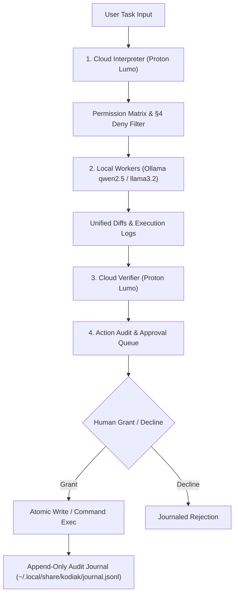

# Kodiak — Local-First AI Task Delegation Workbench

[](LICENSE)
[]()
[]()
[]()

> **Rename Notice:** Formerly known as **Foreman**; renamed in v0.6.0 to **Kodiak** (the bear who runs the job site) to avoid naming collisions with Red Hat's Foreman project.

**Kodiak** is a local-first, privacy-governed AI orchestration workbench built with Rust and Tauri 2. It pairs zero-access cloud reasoning (Proton Lumo) with offline GPU workers (Ollama running `llama3.2` and `qwen2.5-coder`) to interpret, plan, execute, and verify software engineering tasks with cryptographic precision and strict local boundary enforcement.


---

## The §1 Privacy Rule (Non-Negotiable Core)

> **Zero raw source files or unredacted project contents ever leave your local machine.**

Kodiak enforces a strict architectural boundary between planning tiers and local execution:
1. **Cloud Interpreter Tier (Lumo)**: Receives only high-level goal descriptions, relevant project knowledge memories, and directory structure listings. Cloud planning produces a structured sequence of discrete execution steps.
2. **Local Worker Tier (Ollama)**: Local offline models (`qwen2.5-coder:7b` / `14b`, `llama3.2:3b`) perform all file reads, line-range parsing, diff drafts, and compiler output digests on your hardware.
3. **Cloud Verifier Tier (Lumo)**: Reviews unified diffs and step summaries before surfacing an interactive Action Card in the approval queue.
4. **Human-in-the-Loop Enforcer**: No modification touches your filesystem without an explicit Grant on the Action Audit Card.

---

## System Architecture



---

## Prerequisites

- **Linux** (Arch Linux, Fedora, Ubuntu, Debian)
- **Rust toolchain** (1.75+ recommended): `curl --proto '=https' --tlsv1.2 -sSf https://sh.rustup.rs | sh`
- **Node.js** (v18+ or v20+) & npm
- **Tauri 2 system dependencies**:
  - Arch Linux: `pacman -S base-devel webkit2gtk-4.1 openssl curl wget libappindicator-gtk3 librsvg`
  - Ubuntu/Debian: `apt install libwebkit2gtk-4.1-dev build-essential curl wget libssl-dev libayatana-appindicator3-dev librsvg2-dev`
- **Ollama** (for local worker tiers):
  ```bash
  ollama pull llama3.2:3b
  ollama pull qwen2.5-coder:7b
  ollama pull qwen2.5-coder:14b
  ```
- **Proton Lumo via `lumo-tamer`** (Optional / Recommended for primary cloud tier).

---

## Quickstart

### Option A: Arch Linux Package (Recommended)

Build and install the native Arch package using pacman/makepkg:

```bash
git clone https://github.com/your-username/kodiak.git
cd kodiak

# Build and install package
make install
# or manually:
# makepkg -sfci
```

`makepkg` handles packaging, desktop launcher integration (`/usr/share/applications/kodiak.desktop`), and cleanly replaces any legacy `foreman` installation (`conflicts=('foreman') replaces=('foreman')`).

### Option B: Build from Source (Generic Linux)

```bash
git clone https://github.com/your-username/kodiak.git
cd kodiak

# Install frontend dependencies
npm install

# Run in development mode
make dev
# or: npm run tsc && cargo tauri dev

# Build production binary
make build
# or: npm run build && cargo tauri build
```

Binary will be produced at `src-tauri/target/release/kodiak`.

---

## Configuring Your AI Backends

Kodiak reads configuration from `~/.config/kodiak/config.toml`. A complete template is provided in `config.example.toml`.

### 1. Lumo via `lumo-tamer` (Primary Cloud Provider)
Lumo is Proton's privacy-focused LLM. `lumo-tamer` is a local bridge listening on `http://127.0.0.1:3003/v1` translating standard OpenAI chat completions to Proton's API.
- Kodiak defaults to `lumo` via `http://127.0.0.1:3003/v1` out of the box.
- To verify the bridge service:
  ```bash
  systemctl --user status lumo-tamer
  ```

### 2. Provider Tiers & First-Class Gemini Preset
Kodiak supports tiered model routing (`low | medium | high`) for both primary and alternate providers:
- **Two-Level Model Picker**: In Settings, select **Provider → Tier** to preview the exact resolved model ID. Kodiak never guesses model strings; the resolved model field is freely editable.
- **Primary Cloud Tiers (Lumo)**: Standard (`lumo`), Lite (`lumo-lite`), and Max (`lumo-max`).
- **Google Gemini (OpenAI-Compat)**: Supported out of the box via preset:
  - Base URL: `https://generativelanguage.googleapis.com/v1beta/openai/`
  - Tier Low: `gemini-2.5-flash` (fast, efficient planning)
  - Tier High: `gemini-2.5-pro` (deep synthesis & verification)
- **Presets**: Add Provider dropdown pre-fills configurations for Lumo, Gemini, Groq, OpenRouter, and Self-hosted Ollama.

### 3. Ordered Failover Cascade (Privacy-Governed)
When multiple providers exist, Kodiak supports an ordered failover cascade (`[cascade]`):
- **Ordered Failover**: On retryable cloud errors or quota exhaustion (429/503), Kodiak tries configured providers in sequence.
- **Privacy Governance & Consent**: Automatic failover sends task prompts to standby providers without per-request prompts. Alternate providers do not inherit Proton Lumo's zero-access privacy guarantee (see **Charter Tenet 1**); enabling cascade requires explicit user consent (`cascade.consent = true`).
- **Choice Card Fallback**: If all cascade providers are exhausted, the interactive Choice Card appears. **Local-interpret and Defer are strictly excluded from automated cascade**—they remain explicit human decisions.

### 4. Per-Run Diagnostic Logs & Retention
Every task run concurrently writes structured execution logs to `~/.local/share/kodiak/runs/<task-id>/run.log` and sidecar `meta.json`:
- Captures stage transitions, model routing, memory delivery chips, cascade attempts, and classified errors alongside the Live Event Ticker.
- **Configurable Retention**: Set `run_log_level` (`debug|info|warn|error`), `run_log_max_mb` (default 50MB), and `run_log_keep_runs` (default 20 runs) in Settings.
- **Audit Preservation**: Pruning removes oldest run logs only; `history.json` and decision journals are never touched.
- **In-App Viewer**: Click "📜 Run Log" from any history card, task result, or the header to open the monospace log viewer with Copy-All support.

### 5. Privacy Boundary Note
- Proton primary strictly upholds the **Charter Tenet 1 (Your Files Stay Home)**: Zero file contents leave your machine.
- Alternate providers receive task prompts and plan context. They do **not** inherit Tenet 1 guarantees; Kodiak requires explicit session consent before routing tasks to an alternate provider.

---

## The Charter (Operating Tenets)

Kodiak operates under six binding architectural tenets, readable in-app via the **About → The Charter** tab:

1. **Tenet 1 — Your files stay home (privacy):** Raw file contents and directory listings are never sent to any cloud service. Cloud models plan and verify from summaries and condensed catalogs only; heavy reading happens on local models.
2. **Tenet 2 — Nothing happens without you (human authority):** Writes, approvals, permission grants, and degraded-mode choices belong to the human. No persistent permission creep: capability grants die with the task.
3. **Tenet 3 — Some things are always no (hard limits):** A small deny list cannot be talked into, requested via REQUEST steps, or granted under any posture.
4. **Tenet 4 — Honest limits (epistemics):** Kodiak must know what it knows, show receipts (memory delivery chips), refuse to draft from assumed facts (REQUEST mandate), refuse destructive or irrelevant changes, and classify errors honestly instead of retrying hopelessly.
5. **Tenet 5 — Local first (design bias):** Everything sensitive runs on your machine; the cloud is consulted only where its strengths matter (planning, verification) and only for minimal context.
6. **Tenet 6 — A paper trail for everything (auditability):** Every decision, grant, migration, cleaning, probe, and provider call lands in the local journal, readable by you, sendable by no one.

---

## Permission & Safety Model (§4)

Kodiak enforces defense-in-depth safety:
- **Default-Deny Whitelist**: Starts with `whitelist = []`. No file outside an explicitly whitelisted directory can ever be read or written.
- **Granular Grant Matrix (§4.2)**:
  - `READ`: Read & propose diffs only; all changes queue.
  - `CREATE`: READ + create new files planned in advance (never overwrites existing files).
  - `BUILD`: CREATE + `mkdir` + test/build commands.
  - `AUTONOMOUS`: Full R/W/X inside tree (still strictly bounded by the deny list).
- **Hard Deny List (§4.1)**: Blocked globally regardless of grant level:
  - `.git/` internal objects, hooks, and index
  - SSH keys (`id_rsa`, `id_ed25519`, `authorized_keys`)
  - Cloud credentials (`~/.aws`, `~/.gcp`, `~/.config/gcloud`, `*.pem`, `*.key`)
  - Environment secrets (`.env`, `.env.local`, `credentials.json`)
  - Shell profiles (`~/.bashrc`, `~/.zshrc`, `/etc/passwd`, `/etc/shadow`)
- **Destructive Diff Interceptor**: Any diff deleting or replacing $\ge 40\%$ of an existing file is flagged with a high-visibility warning chip.

---

## Data Migration & Upgrading from Foreman

If upgrading from Foreman $\le$ v0.5.0, Kodiak performs an **automatic, atomic zero-data-loss migration** on first launch:
- `~/.local/share/foreman/` $\rightarrow$ `~/.local/share/kodiak/`
- `~/.config/foreman/` $\rightarrow$ `~/.config/kodiak/`
- All audit history (`history.json`), journal entries (`journal.jsonl`), and memories are preserved intact without modifying data-format contracts.
- A `migration_from_foreman` entry is recorded in the new audit journal.

---

## Contributing

Contributions are welcome! Please ensure that:
1. All changes preserve the **§1 privacy rule** (zero unredacted local code sent to the cloud) and the **§4 safety model**.
2. Styling strictly follows [`docs/THEME.md`](docs/THEME.md) (zero hardcoded hex colors; CSS custom properties only).
3. Architecture decisions and rationale are documented in [`docs/DECISIONS.md`](docs/DECISIONS.md).
4. Run `npm run build && cargo test --manifest-path src-tauri/Cargo.toml` before submitting PRs.

---

## License

Licensed under the Apache License, Version 2.0 (the "License"); you may not use this file except in compliance with the License. You may obtain a copy of the License at:

[http://www.apache.org/licenses/LICENSE-2.0](http://www.apache.org/licenses/LICENSE-2.0)

Unless required by applicable law or agreed to in writing, software distributed under the License is distributed on an "AS IS" BASIS, WITHOUT WARRANTIES OR CONDITIONS OF ANY KIND, either express or implied.
